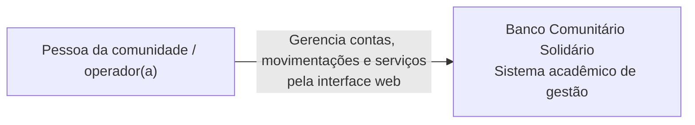
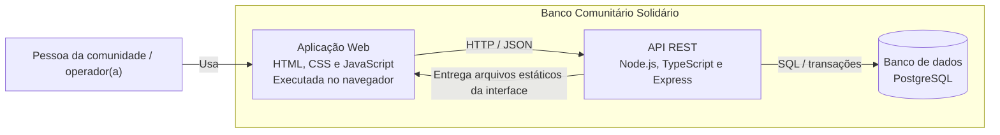
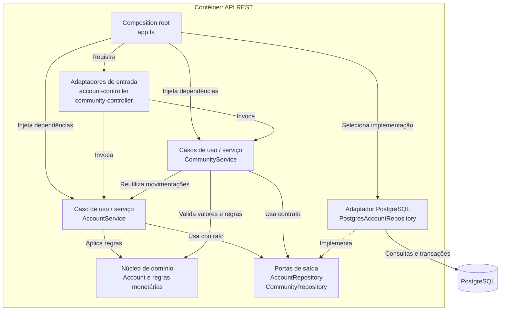

# Visão arquitetural — Banco Comunitário Solidário

## Propósito e escopo

O sistema apoia a operação de um banco comunitário solidário. No escopo atual, permite cadastrar clientes e contas, registrar e consultar movimentações, receber solicitações de crédito, e administrar serviços como cartões, pagamentos, benefícios, responsáveis e relatórios.

Esta visão descreve o sistema acadêmico existente, não uma arquitetura de produção. Em particular, solicitações de crédito são registradas como pendentes: não há análise, aprovação ou liberação automática de recursos. Também não há autenticação/autorização nem integração com provedores externos.

## Estilo arquitetural

O núcleo segue uma arquitetura hexagonal pragmática organizada como monólito:

- `domain` contém regras centrais, como validação monetária e aplicação de movimentações.
- `application` coordena os casos de uso e define contratos de persistência.
- `presentation` adapta requisições HTTP aos casos de uso.
- `infrastructure` implementa os contratos usando PostgreSQL.
- `app.ts` compõe as implementações e registra as rotas.

A separação favorece testabilidade e isolamento de detalhes externos sem introduzir a complexidade operacional de serviços distribuídos. As fronteiras atuais são técnicas; Accounts, Credit, Payments e os demais serviços ainda não são módulos de implantação independentes.

## Elementos e atributos de qualidade

- **Integridade financeira:** valores são calculados em centavos; as alterações de saldo e seus registros associados são transacionais e protegem a conta contra atualizações concorrentes.
- **Modificabilidade e testabilidade:** casos de uso dependem de contratos de repositório, e não diretamente do driver PostgreSQL ou do Express.
- **Simplicidade operacional:** interface web estática e API são servidas pela mesma aplicação Node.js; PostgreSQL é a dependência de persistência.
- **Limitações de segurança e disponibilidade:** a API atual não autentica usuários, não autoriza acesso por conta e depende do banco para operar. Não deve ser tratada como pronta para exposição pública ou uso financeiro real.

## Diagrama de Contexto — C4 Nível 1

O sistema é utilizado por pessoas que operam o banco comunitário e registram ou consultam informações da comunidade. O ator representa o contexto de uso, não uma identidade autenticada pelo sistema atual.

## Diagrama de Contêineres — C4 Nível 2

Os arquivos da interface ficam em `public/` e são servidos pelo próprio processo Express. A API e o PostgreSQL são componentes separados; não há atualmente contêiner de fila, provedor de identidade ou serviço financeiro externo.

## Diagrama de Componentes — C4 Nível 3

O diagrama detalha o contêiner da API e seus componentes principais. O PostgreSQL aparece fora do limite do contêiner para mostrar a dependência do adaptador de persistência.

Os contratos de persistência são definidos em `src/application/account-repository.ts`. `AccountRepository` estende `CommunityRepository`, e `PostgresAccountRepository` implementa o contrato combinado. Os adaptadores HTTP estão em `src/presentation/`; os serviços da aplicação ficam em `src/application/`.

## ADRs incluídos na entrega

Os quatro ADRs abaixo registram decisões relacionadas ao escopo atualmente implementado:

1. [ADR-0001 — Adotar uma arquitetura hexagonal pragmática](adr/ADR-0001-adotar-arquitetura-hexagonal.md)
2. [ADR-0002 — Persistir dados relacionais por meio de um repositório](adr/ADR-0002-usar-postgresql-por-contrato-de-repositorio.md)
3. [ADR-0003 — Representar valores monetários em centavos](adr/ADR-0003-representar-valores-monetarios-em-centavos.md)
4. [ADR-0004 — Registrar crédito solidário sem aprovar ou liberar recursos](adr/ADR-0004-manter-solicitacoes-de-credito-pendentes.md)

Os ADRs `Proposed` 0005–0008 no índice do README são propostas complementares para uma possível evolução do produto. Não fazem parte da contagem dos quatro ADRs desta entrega e não representam funcionalidades presentes no código.

## Possíveis evoluções da arquitetura

Uma pesquisa de controles de segurança e tecnologias futuras, com problemas atendidos, local de integração, módulos impactados e trade-offs, está em [Possíveis evoluções da arquitetura](pesquisa-evolucoes-arquitetura.md). As recomendações priorizam segurança e observabilidade antes de adicionar gateway ou mensageria, e não implicam que essas tecnologias já estejam implantadas.
